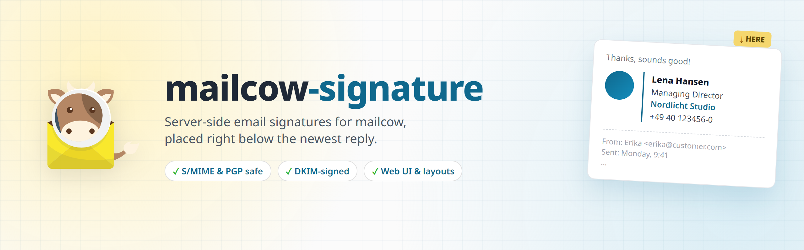
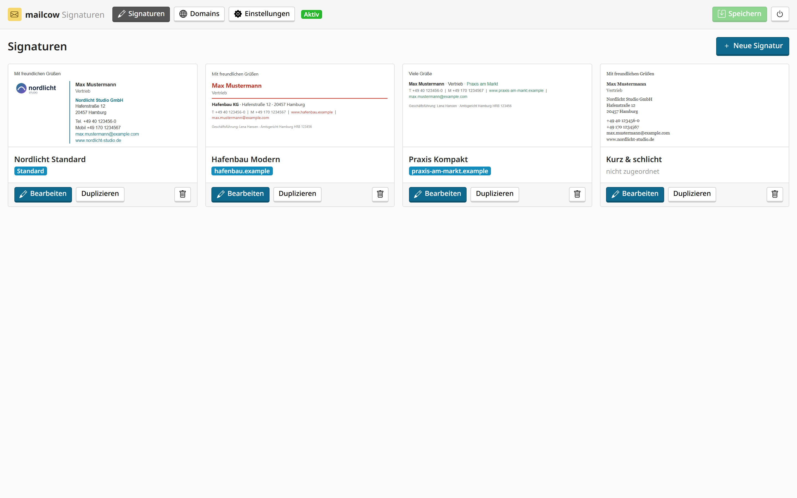
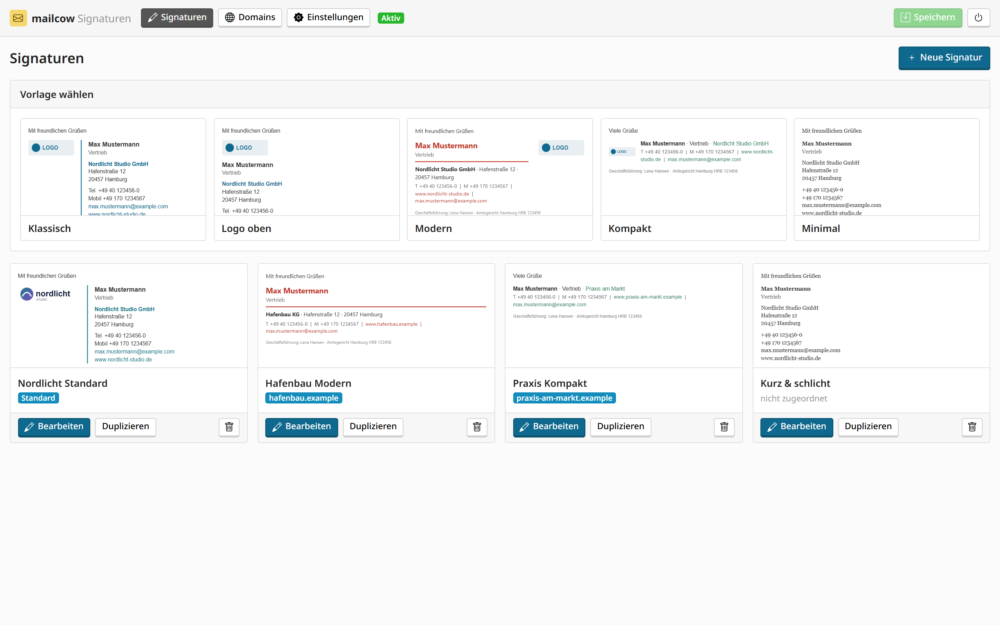
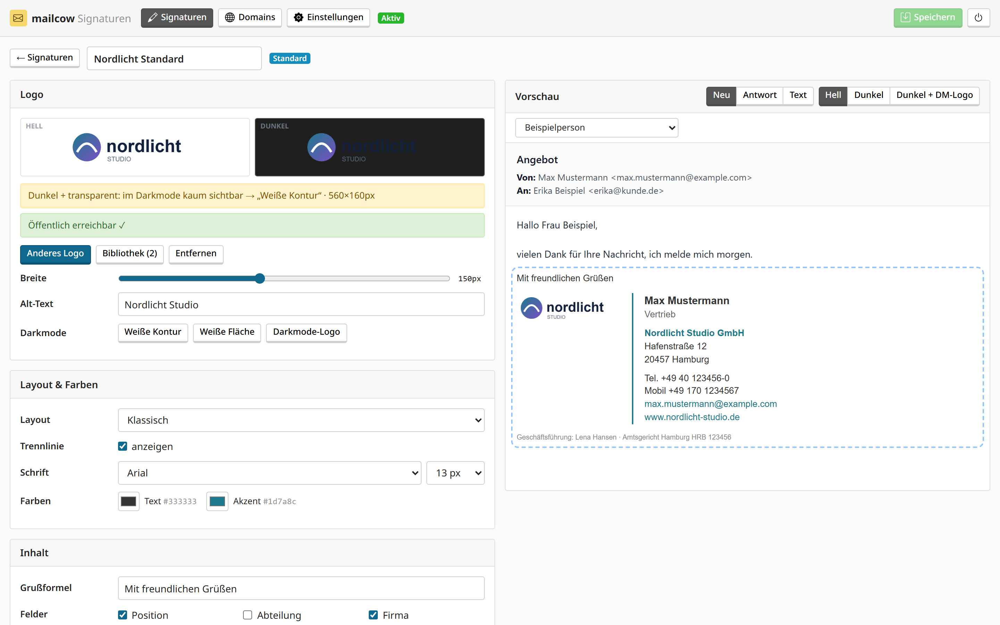
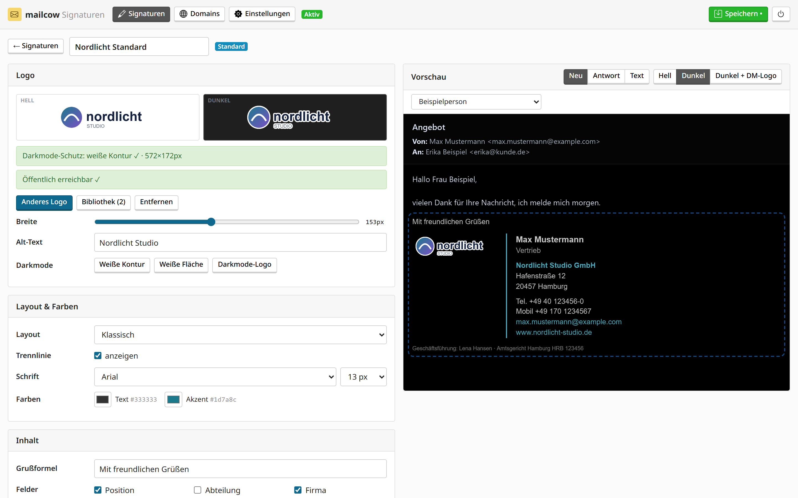
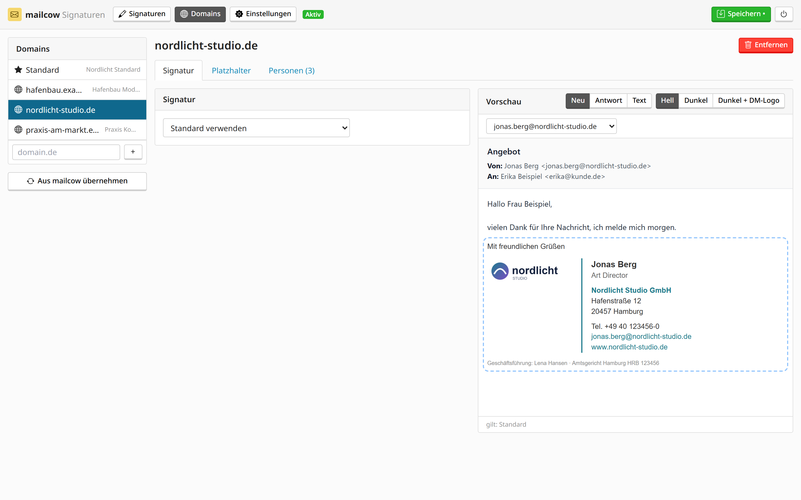
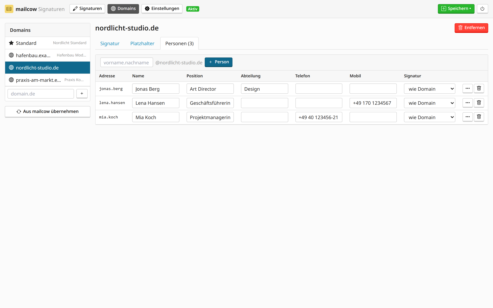
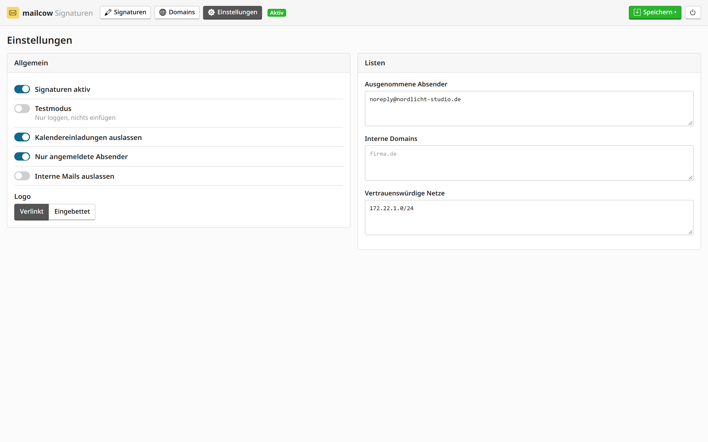
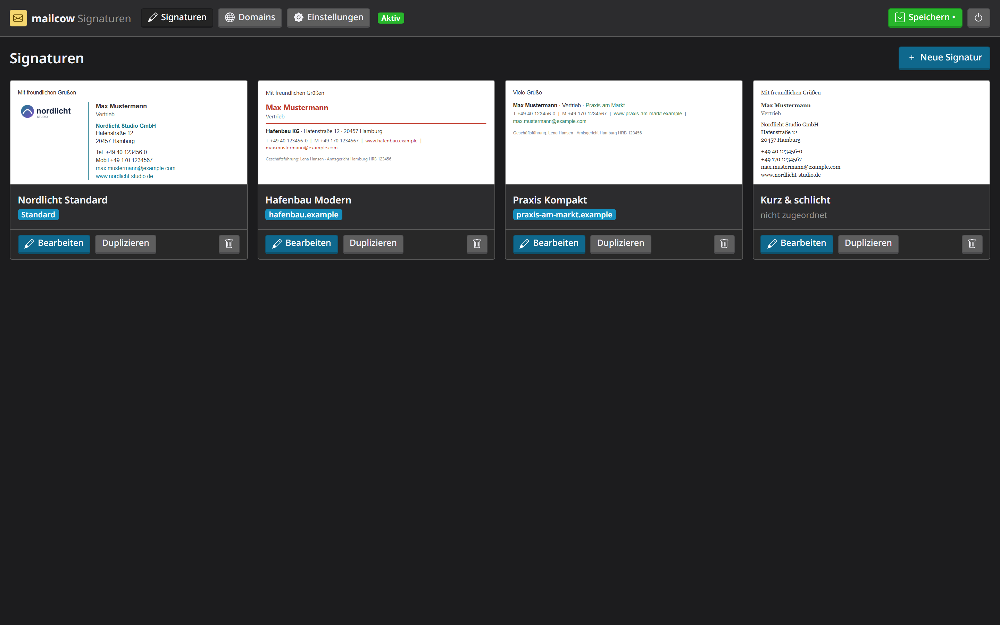

<p align="center">
  
</p>

<p align="center">
  <a href="https://github.com/btwlouis/mailcow-signature/actions/workflows/ci.yml"></a>
  <a href="LICENSE"></a>
  
  
</p>

<p align="center">
  <a href="#quick-install">Quick install</a> ·
  <a href="#screenshots">Screenshots</a> ·
  <a href="#how-it-works">How it works</a> ·
  <a href="#dark-mode--logos">Dark mode</a> ·
  <a href="#testing-with-dry-run">Dry run</a>
</p>

---

**mailcow-signature** adds company-wide email signatures to [mailcow](https://mailcow.email), the way Exclaimer or CodeTwo do it for Microsoft 365: **directly below the newest message, above the quoted history**. mailcow's built-in *domain wide footer* always appends to the very end, after the whole thread.

|  | mailcow domain wide footer | mailcow-signature |
|---|:---:|:---:|
| Position in replies | after the quoted thread | **below the newest reply** |
| Different signature for replies | – | ✓ short, full or none |
| Per domain / per person | per domain | ✓ both |
| Visual editor with layouts | – | ✓ |
| S/MIME, PGP, calendar invites | – | ✓ never touched |

## Features

- 🧩 **rspamd plugin**, using the same hook as mailcow's footer. Runs before DKIM/ARC signing, so **DKIM stays valid**.
- 📬 **Finds the reply position** for Outlook (desktop, OWA, new Outlook, mobile), Gmail, Apple Mail/iOS, Thunderbird, SOGo, Roundcube, Yahoo and Zimbra.
- 🎨 **Signature gallery** with five ready-made layouts (Classic, Logo on top, Modern, Compact, Minimal). Customize logo, colors, font and fields with a live preview.
- 🌗 **Dark-mode aware**: logo analysis, one-click white outline or plate, optional dark mode logo, and a preview that simulates dark mail clients.
- 🏢 **Per domain and per person**, with placeholders (`{{DisplayName}}`, `{{Title}}`, `{{Phone}}`, …) that disappear when empty.
- 🔄 **Domains and mailboxes synced from mailcow** with one click.
- 🖼️ **Logo linked or embedded**: linked via mailcow's own web server, or embedded as an inline attachment so classic Outlook shows it immediately.
- 🧪 **Dry run with live testers**: check everything in the log, or give only yourself the real signature first.
- 🛡️ **Safe by design**: only the text and HTML body bytes are replaced, everything is re-verified, and any error sends the mail unchanged.

## Screenshots

<table>
  <tr>
    <td width="50%"><p align="center"><sub><b>Signature gallery</b></sub></p></td>
    <td width="50%"><p align="center"><sub><b>Ready-made layouts</b></sub></p></td>
  </tr>
  <tr>
    <td><p align="center"><sub><b>Editor: logo check warns about dark mode</b></sub></p></td>
    <td><p align="center"><sub><b>White outline + dark mode preview</b></sub></p></td>
  </tr>
  <tr>
    <td><p align="center"><sub><b>Pick a signature per domain</b></sub></p></td>
    <td><p align="center"><sub><b>People and their fields</b></sub></p></td>
  </tr>
  <tr>
    <td><p align="center"><sub><b>Settings: dry run, live testers, logo mode</b></sub></p></td>
    <td><p align="center"><sub><b>Follows your system theme, like mailcow</b></sub></p></td>
  </tr>
</table>

## Quick install

On the mailcow host, as root:

```bash
curl -fsSL https://raw.githubusercontent.com/btwlouis/mailcow-signature/main/install.sh | sudo bash
```

The installer finds your mailcow directory, backs up the rspamd config to `/var/backups/mailcow-signature/` and installs the plugin. It creates `config.json` with all active mailcow domains, with **dry run on**. It also adds the web UI to `docker-compose.override.yml` (merging into an existing file), generates a UI password and checks that rspamd loaded the plugin.

Then:

1. **Open the web UI** with the printed password. By default it listens on `127.0.0.1:8090` only, so use an SSH tunnel and browse to http://localhost:8090:
   ```bash
   ssh -L 8090:127.0.0.1:8090 root@your-mailcow-host
   ```
   To reach it via VPN or a private network instead, add `--listen <private-ip>` to the installer.
2. **Create a signature** under *Signaturen*, pick it for your domains under *Domains*, and save.
3. **Test** with dry run or live testers, then switch dry run off under *Einstellungen*.
4. **Clear mailcow's domain wide footer** and client-side signatures, otherwise mails get two signatures.

Changes are live within 60 seconds, without a restart.

| Task | Command (append to `curl … \| sudo bash -s --`) |
|---|---|
| Update, keeps your config | run the installer again |
| Web UI on a VPN/private IP | `--listen 10.1.0.4` |
| Plugin only, no web UI | `--no-ui` |
| Uninstall (keeps signatures/config) | `--uninstall` |
| Uninstall everything | `--uninstall --purge` |

<details>
<summary><b>Manual installation</b></summary>

```bash
git clone https://github.com/btwlouis/mailcow-signature.git /opt/mailcow-signature
cd /opt/mailcow-dockerized

# 1. rspamd plugin + data
cp /opt/mailcow-signature/data/conf/rspamd/custom/mailcow_signature.lua data/conf/rspamd/custom/
cp -r /opt/mailcow-signature/data/conf/rspamd/local.d/* data/conf/rspamd/local.d/   # local.d/rspamd.lua must not exist yet
# edit data/conf/rspamd/local.d/mailcow-signature/config.json: set "domains" and "dry_run": true

# 2. Web UI
cp -r /opt/mailcow-signature/data/signature-ui data/
mkdir -p data/web/sig-assets
echo "SIGNATURE_UI_PASSWORD=change-me-to-something-long" >> mailcow.conf
echo "SIGNATURE_UI_API_KEY=" >> mailcow.conf                    # optional, read-only mailcow API key
echo "SIGNATURE_UI_BIND=127.0.0.1" >> mailcow.conf               # or a VPN/private IP
cp /opt/mailcow-signature/docker-compose.override.yml .          # or merge the service into your existing one

# 3. Start
docker compose up -d --force-recreate signature-ui-mailcow
docker compose restart rspamd-mailcow
docker compose logs rspamd-mailcow | grep mailcow_signature     # expect "mailcow_signature: loaded"
```

**Manual uninstall:** `rm data/conf/rspamd/local.d/rspamd.lua && docker compose restart rspamd-mailcow`, then remove the `signature-ui-mailcow` service from `docker-compose.override.yml`.
</details>

## How it works

```
 client ──► postfix ──► rspamd (milter)
                          │
                          ├─ MAILCOW_SIGNATURE (prefilter)
                          │    ├─ outbound + own domain? skip S/MIME, PGP, invites, auto-replies
                          │    ├─ find the reply marker (Outlook, Gmail, Apple, SOGo, …)
                          │    ├─ insert the rendered signature into text/html and text/plain
                          │    └─ re-parse and verify, otherwise leave the mail untouched
                          └─ DKIM / ARC signing  ◄── signs the mail incl. signature
```

- Signatures live in a library (`library.json`). Domains and people point to one of them (`signatures` in `config.json`). On save, the UI generates the template files the plugin reads.
- Only the bytes of the first `text/html` and `text/plain` part are replaced. Headers, attachments and attached messages stay byte-identical, and the original charset and transfer encoding are kept.
- Logos are stored in `data/web/sig-assets/` and served by mailcow's nginx at `https://<mailcow-host>/sig-assets/…`.

## Dark mode & logos

Mail clients recolor text and backgrounds in dark mode, but never images, so a dark logo on a transparent background disappears. The editor analyzes every logo and offers:

| Option | Works in | Effect |
|---|---|---|
| **White outline** (recommended) | all clients | thin white contour around the logo |
| **White plate** | all clients | logo baked onto a rounded white area |
| **Dark mode logo** | Apple Mail, Outlook for Mac/iOS, Thunderbird | alternative image via `prefers-color-scheme` |

**Logo mode** (*Einstellungen*): *Linked* keeps mails small, but classic Outlook for Windows asks before loading external images. *Embedded* attaches the logo inline (CID), so it shows immediately everywhere, but mails get a paperclip. SVG uploads are converted to PNG, because Outlook and Gmail don't render SVG.

## Testing with dry run

With dry run on, the plugin does everything except change the mail. Every outgoing mail from your domains gets a result:

```bash
cd /opt/mailcow-dockerized && docker compose logs -f --since 1m rspamd-mailcow | grep mailcow_signature
```

```
mailcow_signature: dry_run, would insert reply signature for max@example.com
mailcow_signature: max@example.com unchanged (skip: multipart/signed)
```

The same info shows up as the symbol `MAILCOW_SIGNATURE` in the rspamd history (`https://<mailcow-host>/rspamd`). **Live testers** (*Einstellungen*) get the real signature while everyone else stays in dry run.

## Limitations

- The copy in *Sent Items* has no signature, because the client saves it before the server adds one. M365 and Exclaimer behave the same in server mode.
- Unknown clients without a recognizable quote marker get the signature at the end.
- Single-part plain-text mails in `7bit`/`us-ascii` get non-ASCII characters transliterated (ü → ue).

<details>
<summary><b>Files</b></summary>

| Path | Purpose |
|---|---|
| `data/conf/rspamd/custom/mailcow_signature.lua` | rspamd plugin |
| `data/conf/rspamd/local.d/rspamd.lua` | loader (rspamd loads it automatically) |
| `data/conf/rspamd/local.d/mailcow-signature/` | `config.json`, `users.json`, `library.json`, `templates/…`, `assets/` |
| `data/web/sig-assets/` | uploaded logos (public, served by mailcow's nginx) |
| `data/signature-ui/` | web UI server (`app.py`, Python stdlib only) and the built React app (`dist/`) |
| `webui/` | web UI source (React + Tailwind, Vite) |
| `install.sh` | installer / updater / uninstaller |
| `tools/sync_users.py` | CLI alternative to the "Aus mailcow übernehmen" button |
</details>

<details>
<summary><b>Development & tests</b></summary>

```bash
# web UI
cd webui && npm ci
npm run dev      # dev server, proxies /api to app.py on :8090
npm run build    # writes data/signature-ui/dist (commit it, CI checks it is up to date)

# tests
pip install lupa pyyaml
python tests/test_signature.py      # plugin unit tests (LuaJIT)
bash tests/installer_test.sh        # installer against a fake mailcow
bash tests/rspamd_integration.sh    # plugin inside a real rspamd container (Docker)
```

GitHub Actions runs all of these on every push, plus shellcheck, ruff, Lua syntax and the web UI build.
</details>

## License

[MIT](LICENSE). The mailcow logo in the banner belongs to the [mailcow](https://github.com/mailcow/mailcow-dockerized) project. This project is independent and not affiliated with mailcow or The Infrastructure Company GmbH.
